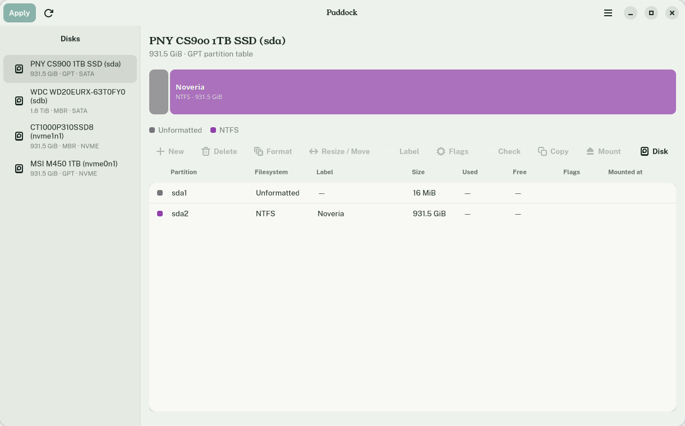
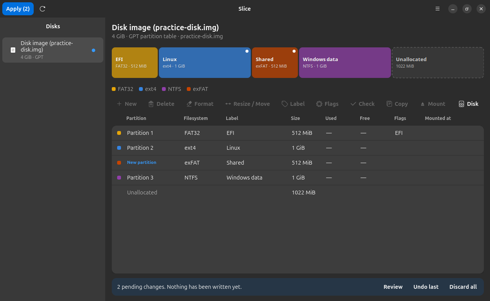
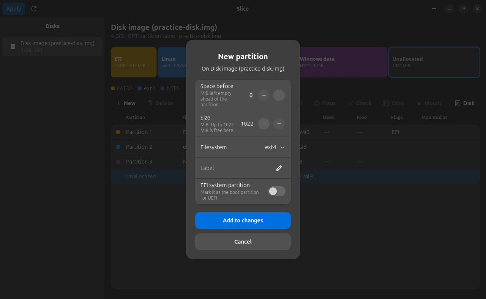
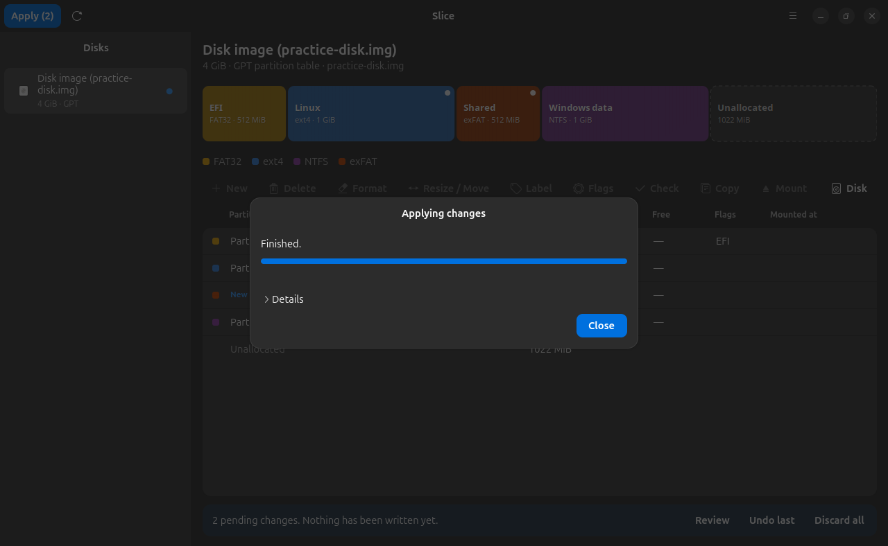

# Slice

A partition manager for Ubuntu. Slice shows each disk as a colored map, and lets you create, delete, format, resize, move, label, copy and check partitions, clone or wipe whole disks, convert between GPT and MBR, and read disk health.



Changes are queued first. The map shows what the disk will look like, you review the list, and nothing is written until you press **Apply**.



## Requirements

- Ubuntu 24.04 or newer, with GNOME (it uses GTK 4 and libadwaita 1.5 or newer)

Slice has only been tested on Ubuntu 26.04 with GNOME 50.

## Install

### With the deb package (recommended)

Download `slice_1.0.1_all.deb` from the [latest release](https://github.com/webhookstudios/slice/releases/latest), then install it:

```bash
sudo apt install ./slice_1.0.1_all.deb
```

Open **Slice** from the apps menu. Reading disks needs no password. Applying changes asks for your administrator password.

To remove it:

```bash
sudo apt remove slice
```

### From source

```bash
git clone https://github.com/webhookstudios/slice.git
```

```bash
cd slice && PYTHONPATH=. python3 -m slicepm
```

`./install.sh` adds a menu entry that runs Slice from the cloned folder.

## Try it without risk

Choose **New practice disk image** from the menu. It makes a file that behaves like a disk, so you can create, resize and format partitions on it freely. Changes to disk images do not ask for a password and cannot touch your real disks. **Open disk image** loads any `.img` file the same way.



## What it can do

| Action | Notes |
|---|---|
| Create, delete | Aligned to 1 MiB. GPT holds up to 128 partitions, MBR up to four primary |
| Format | ext4, ext3, ext2, NTFS, FAT32, exFAT, swap, and Btrfs or XFS when their tools are installed |
| Resize and move | ext2/3/4 and NTFS keep their files when grown or shrunk. Moving copies the data. Partitions with no filesystem resize freely |
| Label, flags | Filesystem label, EFI system partition, and the MBR boot flag |
| Check and repair | ext2/3/4, NTFS, FAT32 and exFAT |
| Copy a partition | To free space on the same or another disk, growing the filesystem if it can |
| Clone a disk | An exact copy onto an equal or larger disk, with new disk and partition IDs |
| Wipe a disk | Quick, overwrite with zeros, or overwrite with random data |
| Convert | GPT to MBR and back |
| Mount, unmount | Through udisks, no password for removable drives |
| Disk health | SMART status, temperature, hours, wear and the attributes worth watching (needs `smartmontools`) |
| Surface test | Reads every block and counts the ones that fail |



## Safety

- Nothing is written until you review the list and press **Apply**, and destructive lists ask you to confirm you have a backup.
- Mounted partitions cannot be changed. Unmount them first.
- Resizing shrinks the filesystem before the partition, so a refusal leaves your data intact.
- Operations run one by one and stop at the first error, with the log kept.
- The part that writes to disks is a small separate program run through `pkexec`. It takes argument lists only, never shell commands, and refuses to open ordinary files when running as root.

## Limitations

- **Tested on disk image files, not on real disks.** Every operation is run for real against images and compared with what the map predicted (`python3 -m unittest discover -s tests`), but the final step on actual block devices has not been exercised. Try it on a spare drive first, and keep backups.
- MBR extended and logical partitions are shown but cannot be changed.
- FAT32, exFAT, Btrfs and XFS cannot be resized, because Ubuntu does not ship an offline tool for them.
- If other partitions on a disk are mounted, the kernel keeps the old table until a reboot. Slice tells you when that happens.
- Moving a partition is not safe against power loss halfway through.

## Development

```bash
python3 -m unittest discover -s tests
```

| File | Purpose |
|---|---|
| `slicepm/model.py` | Disks, partitions and free-space maths |
| `slicepm/ops.py` | Operations, checks, and how each changes the layout |
| `slicepm/scan.py` | Reads disks and images, without root |
| `slicepm/helper.py` | The root-side executor |
| `slicepm/ui/` | The window, disk map and dialogs |

Build the package with `./build-deb.sh`, which needs only `dpkg-deb`.

## License

GPL-2.0-or-later. See [LICENSE](LICENSE).
